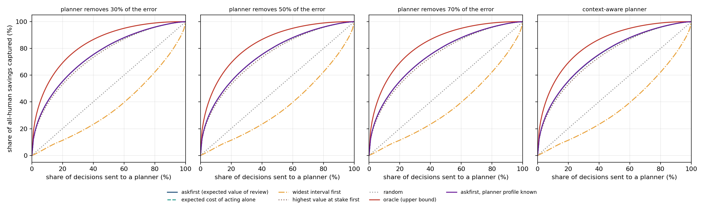

# askfirst

When should a replenishment system order on its own, and when should it ask a planner?



## What I did
- Used the public Walmart M5 data: weekly demand for 30,490 store-item series, tested on 48 weeks (1,460,477 weekly ordering decisions).
- Forecast weekly demand with a gradient-boosted Poisson model, put a calibrated (conformal) interval around each forecast, and turned it into an order with the newsvendor rule.
- Simulated a planner with limited review time and compared six ways of choosing which decisions to send to them: random, widest interval, highest value at stake, expected cost of acting alone, a Monte Carlo value of review, and an oracle that knows the true benefit.
- Costed the workload and the best share of decisions to review for different prices of a review. The costs (lost margin 30% of price, surplus 40% of price for foods and 8% otherwise, a review at 0.67) are assumptions in `configs/default.toml`.
- **v2:** improved the forecast (19 more features, three models averaged) and trained a router that predicts the benefit of a review from the same inputs plus recent forecast errors.

## Results
- Sending the 10% of decisions with the widest interval to a planner captures **6.0%** of the saving a full review would give; random captures 10.0%. Wide intervals sit on slow items where an error costs little.
- Ranking by the Monte Carlo value of review captures **40.0%** at a 10% budget (95% interval 39.5% to 40.5%); highest value at stake captures 38.1%; the oracle 52.6%.
- Half of the all-review saving needs 17% of decisions reviewed; 80% needs 47%. A 5% budget is 1,522 reviews a week, about 25 planner hours.
- With a review priced at 0.67 the best share to review is 60% and the net saving 28.9%; at four times that price the best share is 9%.
- The 80% interval covers 79.6% of test demand (78.6% in the highest-value decile). Forecast error is WAPE 0.363 against 0.385 for a 4-week average.

**v2:**

| | v1 | v2 |
|---|---|---|
| forecast error (WAPE) | 0.3628 | **0.3546** |
| cost of acting alone | 0 | **-2.3%** |
| saving captured at a 10% review budget | 40.0% (Monte Carlo score) | **41.1%** (learned router; Monte Carlo on the v2 forecast: 39.6%) |

The learned router captures 18.4%, 29.3%, 41.1%, 56.9% and 68.2% of the saving at budgets of 2%, 5%, 10%, 20% and 30%, against 24.9%, 38.3%, 52.1%, 69.0% and 79.5% for the oracle. Details: [docs/V2.md](docs/V2.md).

Tables: [results/results.md](results/results.md).

## How it was built

```
M5 data -> weekly series -> features -> Poisson boosted model -> conformal quantiles
        -> newsvendor order -> Monte Carlo value of review (or learned router)
        -> rank decisions inside each week -> review budget -> cost against budget
```

All settings are in `configs/default.toml`. 18 tests.

```bash
pip install -e ".[dev]"
python -m askfirst.experiment --config configs/default.toml   # about 2 minutes
python -m askfirst.report
pytest
```

Put `calendar.csv`, `sales_train_validation.csv` and `sell_prices.csv` from the M5 forecasting data in `data/raw/`.

## Tech stack
Python, NumPy, pandas, scikit-learn, matplotlib, conformal prediction, Monte Carlo simulation, pytest.

## Data
M5 Forecasting competition data (Makridakis et al.), Walmart sales, prices and calendar.
